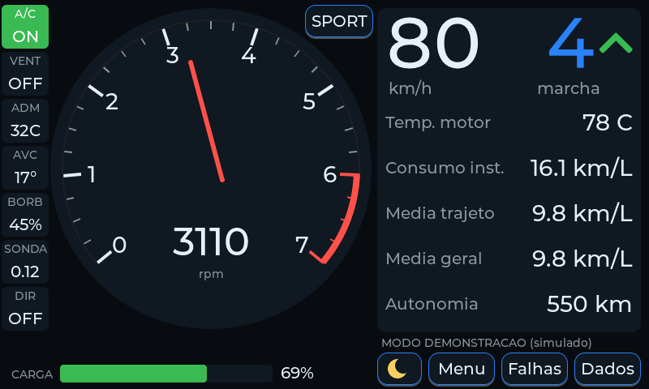
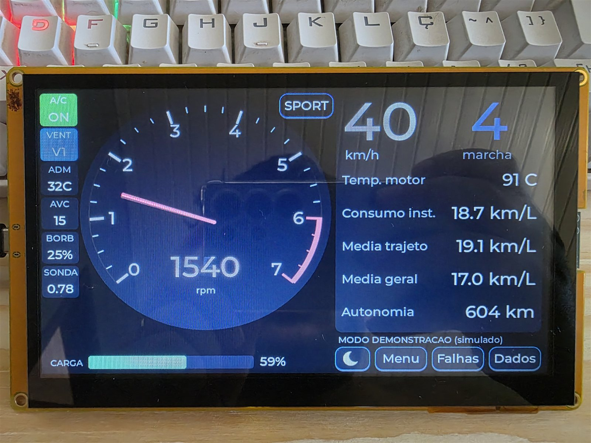
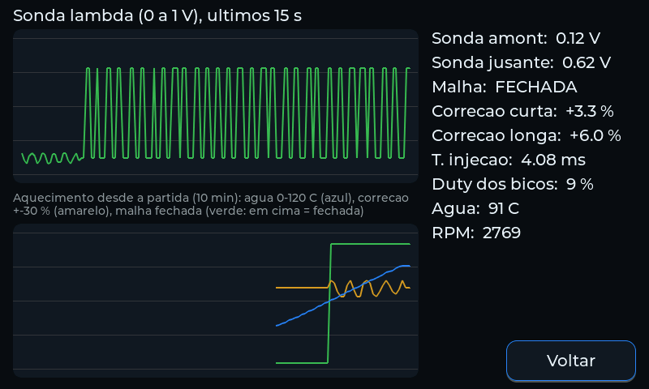
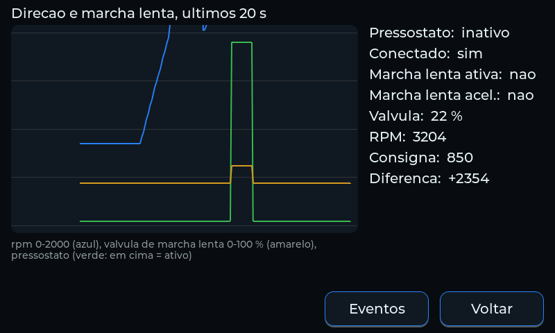
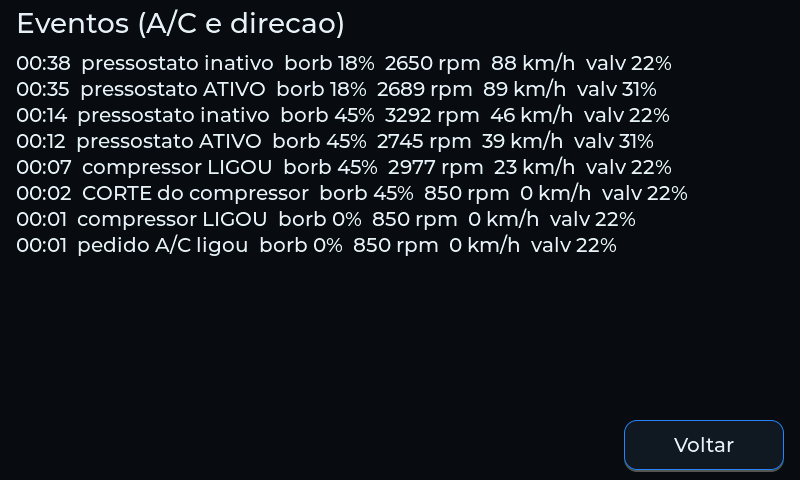
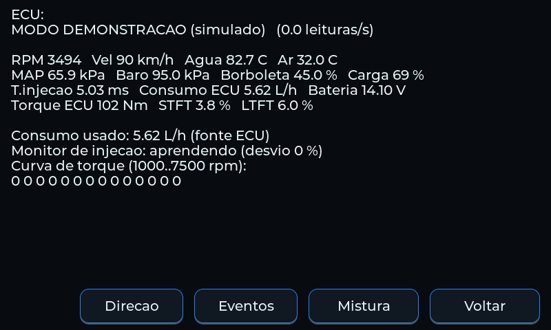
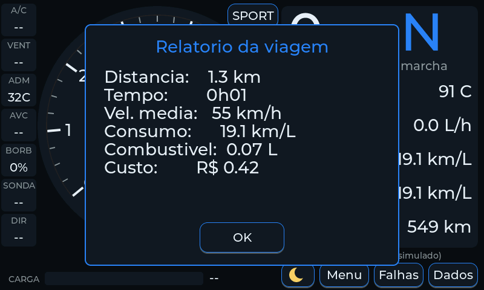
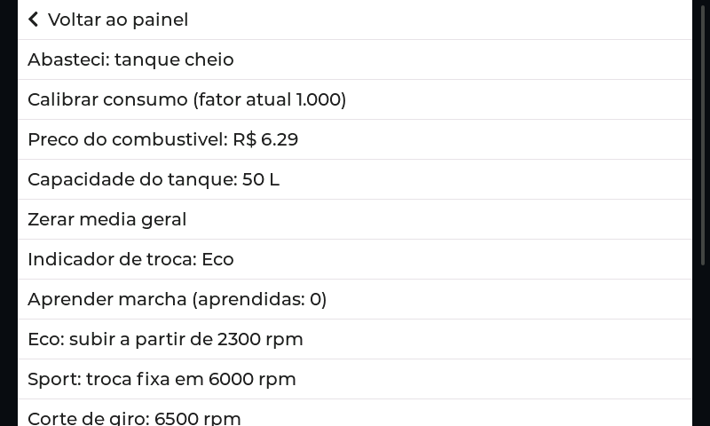
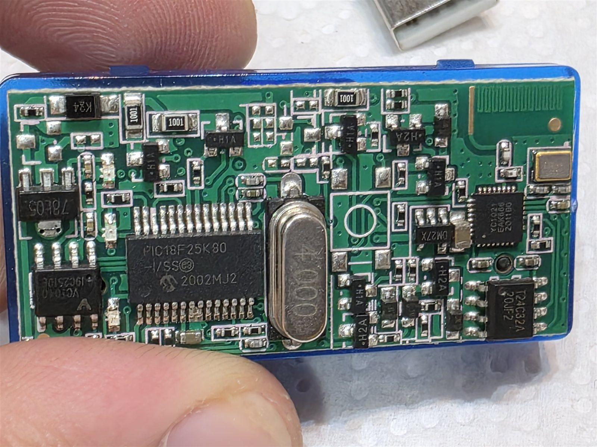
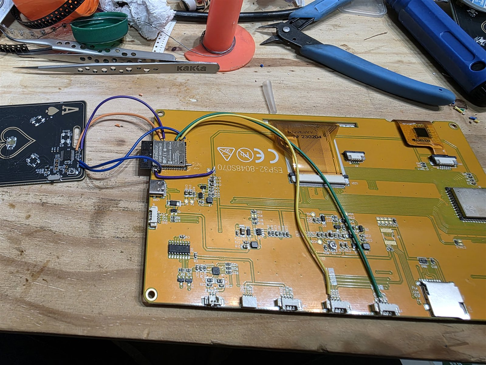

# AutoClio

Repositorio dedicado a armazenar e discutir ideias para melhorias e incrementações no carro usando eletrônica embarcada.

O primeiro projeto é um **painel novo para Renault Clio II / Twingo I**: uma tela de 7" que lê a injeção eletrônica pela tomada de diagnóstico e mostra, além de velocidade e consumo, dados que o painel original nunca mostrou.



*As imagens das telas são geradas no PC pelo próprio código do painel, em modo demonstração (valores simulados). Veja [`painel-clio/tools/sim`](painel-clio/tools/sim).*



## O que é

```
Tomada OBD ──> ELM327 ──(fio ou Bluetooth)──> tela ESP32-S3 de 7"
```

| Pasta | O que tem |
|-------|-----------|
| [`painel-clio/`](painel-clio/) | Firmware do painel (ESP-IDF + LVGL) para a tela ESP32-8048S070C: ESP32-S3, 800x480, touch capacitivo. |
| [`ponte-obd-bt/`](ponte-obd-bt/) | Firmware de um ESP32 comum que conecta num ELM327 Bluetooth e repassa tudo por fio para o painel. Serve para quem não quer abrir o ELM327. |

O painel fala dois protocolos:

- **Renault (KWP2000 pela linha K)**, com as mesmas tramas que o DDT4All usa. Dá acesso a dados que o OBD2 genérico não tem, como válvula de marcha lenta, pressostato da direção e estados do ar-condicionado. Os perfis das centrais (famílias Sirius e SIM32 de Clio II / Twingo I) são gerados a partir dos arquivos do DDT4All pelo script `painel-clio/tools/ddt2profile.py`.
- **OBD2 padrão (SAE J1979)**, para qualquer carro que responda aos PIDs do modo 01 e aos códigos de falha do modo 03.

## Por que fazer isso

A ideia não é só deixar o painel bonito. A central de injeção sabe muita coisa que o motorista nunca vê, e a maioria dos scanners mostra esses números como uma lista que ninguém consegue acompanhar dirigindo. Aqui cada tela foi pensada para responder uma pergunta de diagnóstico, **observando o carro em uso real** e não só parado na oficina.

O painel não diagnostica sozinho. Ele mostra a tendência e o momento em que algo sai do normal, e a conclusão continua sendo de quem olha.

### Painel principal

Conta-giros, velocidade e marcha em números grandes, temperatura do motor, consumo instantâneo, médias e autonomia. Na coluna da esquerda ficam quadros com o estado da injeção, que mudam de cor quando algo está ativo: ar-condicionado, ventoinha, temperatura do ar de admissão, avanço de ignição, borboleta, sonda e pressostato da direção. Embaixo, uma barra com a carga do motor.

**Como ajuda a diagnosticar:**

- **Temperatura em número**, em vez do ponteiro que fica parado no meio: dá para ver se o motor demora a aquecer (termostato travado aberto) ou se a ventoinha entra na temperatura certa.
- **Indicador da ventoinha**: confirma se a central está pedindo a ventoinha. Se o indicador acende e a ventoinha não gira, o defeito está no relé ou no motor da ventoinha, e não no sensor.
- **Indicador do pressostato da direção**: muda de cor em manobra. Se nunca acende, ou acende sozinho em linha reta, o pressostato ou o chicote merecem atenção.
- **Alertas de temperatura alta e de bateria/carga baixa** em tela cheia, antes de virar problema.

### Mistura



Gráfico da sonda lambda dos últimos 15 segundos, correções de combustível de curto e longo prazo, tempo de injeção, ocupação (duty) dos bicos, avanço e um registro dos primeiros 10 minutos depois da partida com temperatura da água, correção total e estado da malha (aberta ou fechada).

**Como ajuda a diagnosticar:**

- **Sonda oscilando ou parada**: uma sonda saudável fica alternando entre rico e pobre. Sonda lenta ou presa num dos lados aparece na hora no gráfico.
- **Correções de combustível**: correção positiva alta e constante sugere mistura pobre sendo compensada (entrada falsa de ar, pressão de combustível baixa, bico sujo). Negativa sugere excesso (bico gotejando, regulador de pressão, sensor de temperatura lendo frio).
- **Duty dos bicos**: mostra quanta folga os bicos ainda têm em carga alta. Útil para saber se os bicos dão conta de um combustível com mais etanol ou de uma preparação, antes de trocar qualquer peça.
- **Registro do aquecimento**: mostra quanto tempo o motor leva para entrar em malha fechada e como a correção se comporta durante a fase fria. Serve para comparar o comportamento a frio entre combustíveis ou entre um dia e outro.

### Monitor de injeção

Com o motor quente, o tempo de injeção num mesmo ponto de rotação e carga deveria se repetir. O painel aprende uma linha de base para cada faixa e avisa quando o valor atual fica longe dela por vários segundos.

**Como ajuda a diagnosticar:** pega uma mudança lenta que não acende luz nenhuma, como bico entupindo aos poucos, filtro de combustível saturando ou uma entrada de ar que aparece com o tempo. O aviso indica tendência, não a causa.

### Direção e marcha lenta



Gráfico de 20 segundos com rotação, abertura da válvula de marcha lenta e estado do pressostato da direção hidráulica, mais a rotação desejada pela central e a diferença para a rotação real.

**Como ajuda a diagnosticar:** quando se esterça o volante parado, a bomba da direção rouba força do motor. O pressostato avisa a central, que abre a válvula de marcha lenta para compensar. Nessa tela dá para ver a sequência inteira: o pressostato ativou? A válvula abriu? A rotação caiu mesmo assim? Isso separa um pressostato que não avisa de um atuador de marcha lenta sujo ou lento, que são defeitos com o mesmo sintoma (motor quase morrendo em manobra).

### Eventos



Lista com hora dos últimos acontecimentos: pedido de ar-condicionado, compressor ligando e desligando, corte do compressor pela central, mudanças do pressostato e quedas bruscas de rotação. Cada linha guarda rotação, velocidade, borboleta e abertura da válvula de marcha lenta naquele instante.

**Como ajuda a diagnosticar:** defeito intermitente é o mais difícil de achar porque nunca acontece na frente do mecânico. Com a lista dá para voltar depois e ver o que estava acontecendo no momento exato: se a rotação despencou logo depois de o compressor entrar, se a central cortou o ar numa arrancada como deveria, ou se a rotação caiu sem nenhum outro evento por perto.

### Dados ao vivo e falhas



Todos os valores brutos lidos da central numa tela só, com a central identificada e a quantidade de leituras por segundo. Na tela de falhas é possível ler e apagar os códigos de falha (OBD modo 03).

**Como ajuda a diagnosticar:** permite conferir um sensor contra o outro (temperatura do ar e da água iguais com o motor frio, pressão do coletor igual à atmosférica com o motor desligado, tensão da bateria subindo com o motor ligado) e ler os códigos sem precisar de scanner.

### Computador de bordo e trocas de marcha

Consumo instantâneo e médio, autonomia, custo e relatório ao fim de cada viagem. O consumo é calculado a partir do que a central informar, nesta ordem de preferência: consumo da própria central, tempo de injeção, sensor de fluxo de ar ou pressão do coletor. Um fator de correção é ajustado comparando com os litros da bomba ao completar o tanque.

| Relatório da viagem | Menu |
|---|---|
|  |  |

A marcha é deduzida pela relação entre rotação e velocidade, depois de aprendida uma vez para cada marcha. O indicador de troca tem modo econômico e modo Sport, com aviso de troca em tela cheia.

**Como ajuda a diagnosticar:** consumo médio subindo sem mudança de trajeto é um dos primeiros sinais de que algo mudou no motor.

## Hardware

- Tela **ESP32-8048S070C** (ESP32-S3, 7", 800x480, touch GT911).
- **ELM327** v1.5. Pode ser ligado por fio direto na tela, tirando o módulo Bluetooth dele, ou usado como está, com a ponte.
- Para a ponte: qualquer **ESP32 clássico** (WROOM-32, DevKit V1, NodeMCU-32S). Precisa ser o clássico porque o ELM327 usa Bluetooth Classic, que o ESP32-S3 não tem.
- Alimentação de 5 V por um conversor automotivo de 12 para 5 V.

| ELM327 aberto | ESP32 da ponte ligado na traseira da tela |
|---|---|
|  |  |

Ligações, pinos e opções de configuração estão no [README do painel](painel-clio/README.md).

## Compilar

As duas pastas são projetos ESP-IDF independentes (versão 5.3 ou mais nova).

```bash
cd painel-clio
idf.py set-target esp32s3
idf.py build flash monitor
```

```bash
cd ponte-obd-bt
idf.py set-target esp32
idf.py build flash monitor
```

O painel tem um **modo demonstração** no menu, que simula um carro andando e permite ver as telas na bancada, sem carro e sem ELM327. A lógica de cálculo (consumo, viagem, marcha, monitor de injeção e decodificação) também roda em testes no PC com `make -C painel-clio/test`.

Para gerar de novo as imagens das telas no Windows, sem placa (precisa do [Zig](https://ziglang.org) e de ter rodado `idf.py build` uma vez, para o LVGL ser baixado):

```powershell
powershell -File painel-clio\tools\sim\build.ps1
```

## Estado e próximos passos

Projeto em desenvolvimento, testado num Clio II 1.6 16V (K4M) com central Sirius 32N. As outras centrais da tabela foram geradas a partir dos arquivos do DDT4All e ainda não foram testadas em carro.

Ideias na fila:

- Sensor de luz para ajustar o brilho sozinho.
- Sinais que não passam pela tomada de diagnóstico, lidos direto do chicote com uma placa própria.
- Versão para o Twingo.

## Aviso

Projeto de hobby, sem garantia nenhuma. Apagar códigos de falha e mexer no chicote do carro é por sua conta e risco. Não mexa na tela dirigindo.

## Créditos

Projeto de Joiro Gomes. Os perfis das centrais Renault vêm do banco de dados do [DDT4All](https://github.com/cedricp/ddt4all).
